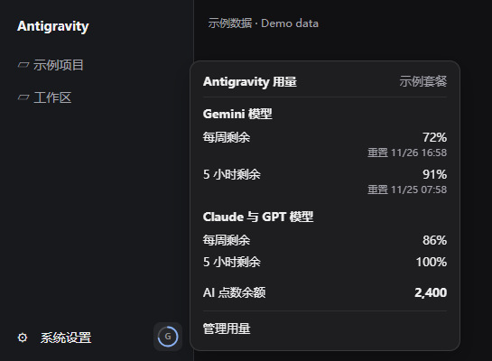

# Antigravity Usage Ring

[English](#english)

在 Antigravity 桌面端左下角「系统设置」旁边加一个额度圆环，不用切页面就能随时看剩余配额。

圆环对应 Gemini 每周剩余额度（正常蓝色，低于 25% 变黄，低于 10% 变红）。鼠标放上去会弹出详情面板，点一下图标可以固定住；面板里会列出各模型组的每周和 5 小时剩余额度、重置时间和 AI 点数余额，点底部的「管理用量」可以跳到 App 自带的「模型与用量」页面。界面语言跟着主题的中文化开关走。

## 安装

需要搭配 [Antigravity Codex Theme](https://github.com/nkjDSLcvanv/antigravity-codex-theme) 使用：

1. 确认主题目录的 `user/config.json` 中已开启 `customJs`。
2. 打开 `~/.gemini/antigravity/codex-theme/user/custom.js`（已有自定义脚本的话记得先备份）。
3. 把 [usage-ring.js](usage-ring.js) 的内容追加到文件末尾并保存。

保存后主题会自动重新加载。更新时替换掉 `// BEGIN Antigravity Usage Ring` 到 `// END Antigravity Usage Ring` 之间那段就行，卸载的话直接删掉这段或恢复备份。

## 说明

- 已在 Windows 10 的 Antigravity 2.35.0 和 Antigravity Codex Theme 1.3.3 上测试通过。
- 额度直接从 App 当前登录态里读，默认每 5 分钟刷新一次，悬停打开面板且距离上次超过 1 分钟时也会顺便刷一下，不会写本地文件，也不会把数据发到别处。
- 实现方式依赖于页面里的 React 内部状态，如果以后 Antigravity 更新改了结构导致失效，删掉脚本回去用自带的「模型与用量」页面即可。
- 独立小脚本，与 Google / Antigravity 官方无关。

---

## English

A small quota ring next to **Settings** in the bottom-left sidebar of the Antigravity desktop app, so you don't have to open Settings just to check what's left.

The ring tracks your remaining Gemini weekly quota (blue by default, yellow below 25%, red below 10%). Hover to preview the breakdown, or click the ring to keep the popover open. It lists weekly and 5-hour quotas for each model group, reset times, and your AI credits balance, with a **Manage usage** button that opens the built-in **Models & Usage** page. UI language follows the theme's Chinese localization toggle.

### Install

Requires [Antigravity Codex Theme](https://github.com/nkjDSLcvanv/antigravity-codex-theme):

1. Make sure `customJs` is enabled in the theme's `user/config.json`.
2. Open `~/.gemini/antigravity/codex-theme/user/custom.js` (back it up first if you already have custom code there).
3. Append [usage-ring.js](usage-ring.js) to the end of the file and save.

The theme picks up the change automatically. To update, replace the block between `// BEGIN Antigravity Usage Ring` and `// END Antigravity Usage Ring`. To uninstall, remove that block or restore your backup.

### Notes

- Tested on Windows 10 with Antigravity 2.35.0 and Antigravity Codex Theme 1.3.3.
- Pulls quota and credit info directly from the app's current session. Refreshes every 5 minutes in the background (and on popover open if the last check was over a minute ago). Nothing is written to disk or sent elsewhere.
- Relies on the app's internal React state, so a future Antigravity update could break it. If that happens, just remove the script and use the built-in **Models & Usage** page.
- Independent script for Antigravity Codex Theme; not affiliated with Google or Antigravity.

## License

[MIT](LICENSE)
